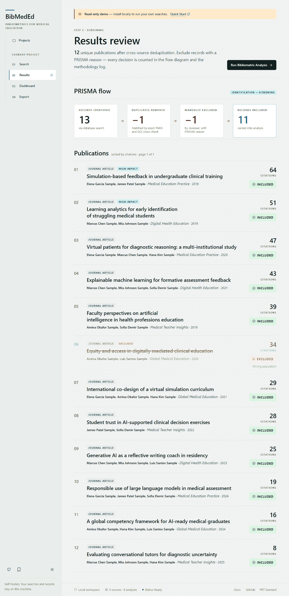
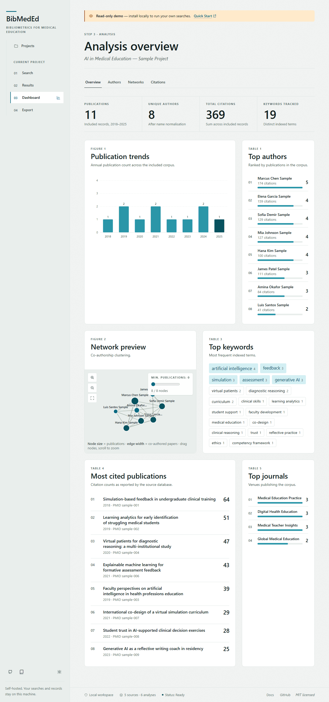

# Try a sample review

Follow a small example about AI in medical education, then inspect the files BibMedEd generates for manuscript preparation. The project uses synthetic records and screening decisions. You can view the example and download its files without installing BibMedEd.

[Open the interactive sample](https://ata381.github.io/BibMedEd/demo/projects/1/results/){ .md-button .md-button--primary }

You can inspect the search strategy, explore the charts, and download reports in the sample. [Install BibMedEd](deploy.md#quick-start) to run a search on your own topic or save project changes.

## See what happened during screening

The sample starts with 13 records. BibMedEd removes one duplicate. A reviewer excludes one record with the reason “Wrong population,” leaving 11 for analysis.

[Download the sample PRISMA flow diagram](assets/sample-review/prisma-flow.svg){ download }

## Check the analysis

The analysis uses the 11 included records. On the dashboard, you can see how publications changed over time and which authors published most often in this corpus.

## Take a reporting file with you

- [Download the sample BIBLIO checklist](assets/sample-review/biblio-checklist.txt){ download="sample-biblio-checklist.md" } to see evidence filled from the project and which items still need manuscript locations or author input.
- [Download the sample PRISMA-S search appendix](assets/sample-review/prisma-s-appendix.txt){ download } to see the recorded search steps and how the export handles missing details. This sample uses seeded data, so there is no live database search behind its counts.

You can also [run the sample locally](deploy.md#run-the-demo-locally).
